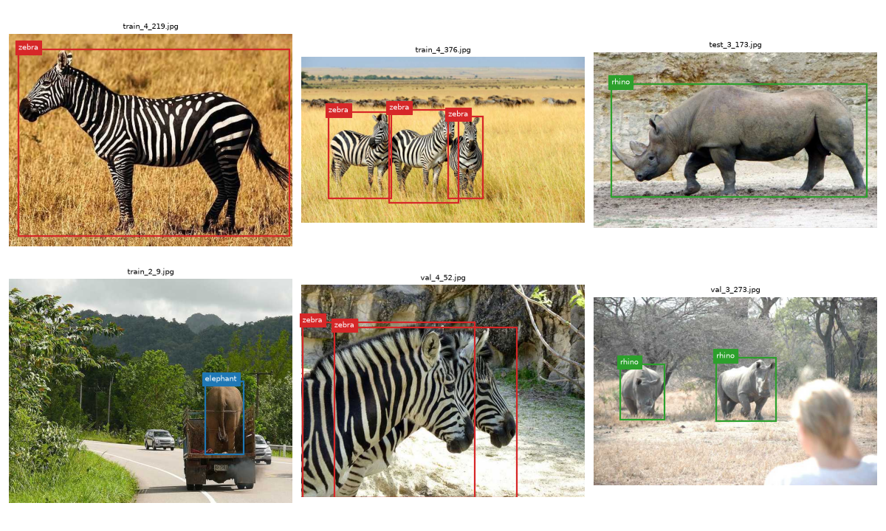
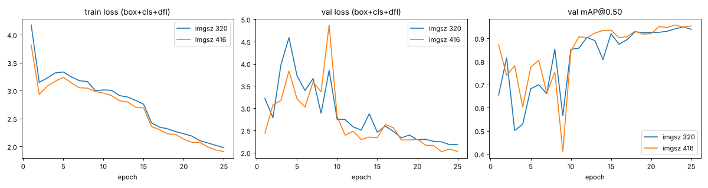
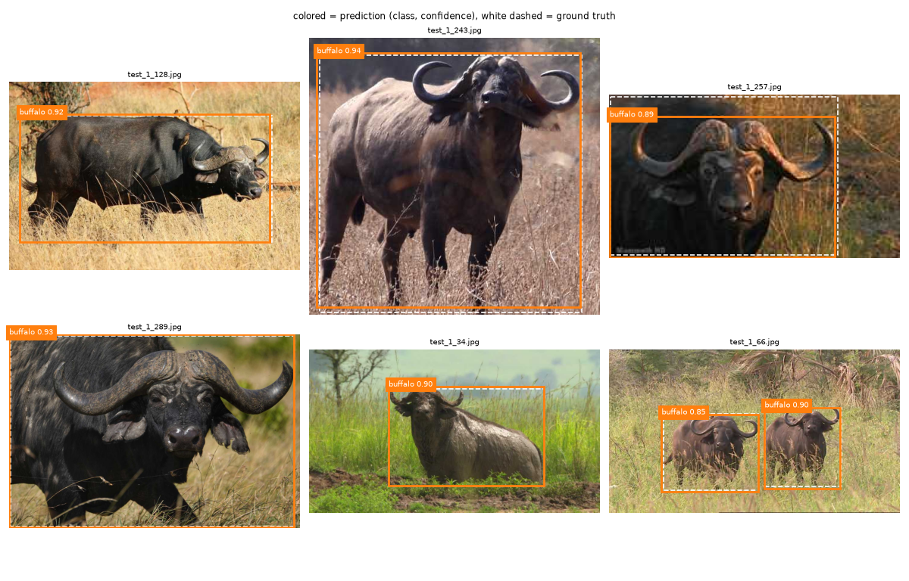
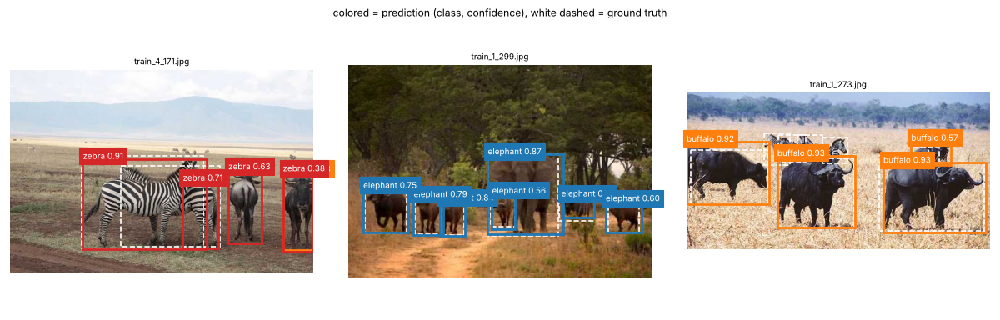

# African Wildlife Detector

CSCI1409 Deep Learning, bonus project. Fine-tuning a pretrained YOLO11n to find and classify 4 African animals: **buffalo, elephant, rhino, zebra**.

[](https://colab.research.google.com/github/NoName376/african-wildlife-detector/blob/main/african_wildlife_detector.ipynb)

## Task

Object detection: for every animal in a photo, predict a bounding box and a class. One photo can have several animals and different classes.

## Dataset

| | |
|---|---|
| Source | [Ultralytics African Wildlife](https://docs.ultralytics.com/datasets/detect/african-wildlife/), [zip](https://github.com/ultralytics/assets/releases/download/v0.0.0/african-wildlife.zip) |
| License | AGPL-3.0 (LICENSE.txt inside the zip) |
| Classes | 0 buffalo, 1 elephant, 2 rhino, 3 zebra |
| Format | YOLO txt: one line per object, `class x_center y_center width height`, all normalized to 0–1 |
| Size | 1,504 images, 2,685 boxes |

### What I checked and changed

1. **Leakage between splits.** The original split has 20 exact duplicate images that are in two different splits (for example the same buffalo photo in train and test). I compared all images with a perceptual hash (`imagehash.phash`) and found 66 groups of duplicates and near-duplicates (resized or slightly cropped copies).
2. **New split.** `scripts/resplit.py` puts images whose hash distance is ≤ 10 into the same group (union-find), shuffles the groups with `random.Random(0)` and fills train / val / test up to 70% / 15% / 15% of images. A whole group always goes to one split. After this there are 0 duplicate pairs between splits.
3. **Wrong labels.** Each original file name starts with the class folder (1 buffalo, 2 elephant, 3 rhino, 4 zebra). I listed images where the boxes don't contain the folder class and looked at them. 5 were really wrong and are fixed in `scripts/fix_labels.py`: 4 rhino photos labelled as zebra and 1 photo of 3 zebras labelled as buffalo. 1 more was an elephant in the zebra folder with a correct label.
4. Every image has at least one box, all class ids are 0–3 and all box values are inside 0–1 (`scripts/check_data.py`, output in `results/data_check.txt`).

New file names are `<original split>_<class folder>_<number>.jpg`, so every image can be traced back to the original zip.

### Split (after resplit and label fixes)

| split | images | boxes | buffalo | elephant | rhino | zebra |
|---|---|---|---|---|---|---|
| train | 1053 | 1890 | 359 | 553 | 403 | 575 |
| val | 226 | 410 | 93 | 102 | 91 | 124 |
| test | 225 | 385 | 99 | 93 | 69 | 124 |



## How to run

**Colab:** click the badge above, choose a T4 GPU runtime and run all cells. The notebook installs the pinned packages, downloads and prepares the data, trains both runs, compares them, tests the final one and shows predictions. Set `TRAIN = False` to skip training and use the weights from `weights/`.

**Locally:**
```bash
git clone https://github.com/USERNAME/african-wildlife-detector.git
cd african-wildlife-detector
pip install -r requirements.txt
python scripts/prepare_data.py
python scripts/train.py --name baseline_320 --imgsz 320
python scripts/train.py --name imgsz_416 --imgsz 416
python scripts/evaluate.py --split val
python scripts/evaluate.py --split test --runs FINAL_RUN
python scripts/predict_and_failures.py --run FINAL_RUN
```

## Files

| path | what it is |
|---|---|
| `african_wildlife_detector.ipynb` | Colab notebook, runs everything end to end |
| `requirements.txt` | pinned versions: ultralytics 8.4.216, imagehash 4.3.2 (torch comes with Colab; I used torch 2.15, Python 3.13) |
| `configs/african_wildlife.yaml` | dataset config |
| `scripts/prepare_data.py` | downloads the zip, runs `resplit.py` and `fix_labels.py` |
| `scripts/check_data.py` | counts images/boxes per split, checks for empty or broken labels and duplicates |
| `scripts/train.py` | trains one run and saves its training time |
| `scripts/evaluate.py` | precision, recall, mAP@0.50 on val or test |
| `scripts/predict_and_failures.py` | predictions on test, matches them with ground truth, lists missed / wrong-class / false boxes |
| `scripts/draw.py`, `show_gt.py`, `compare_curves.py` | figures |
| `results/` | logs, curves, metrics and pictures for both runs |
| `weights/best.pt` | final model (imgsz 416), `weights/baseline_320.pt` is the baseline |

**Final checkpoint:** [weights/best.pt](https://github.com/USERNAME/african-wildlife-detector/raw/main/weights/best.pt) (5.5 MB)

## Training setup

| setting | value |
|---|---|
| framework | Ultralytics 8.4.216 (PyTorch) |
| model / initial weights | YOLO11n, COCO-pretrained `yolo11n.pt` |
| epochs | 25 |
| batch size | 16 |
| optimizer / learning rate | SGD, lr0 = 0.01 (3 warmup epochs, linear decay) |
| image size | 320 (baseline), 416 (experiment) |
| augmentation | Ultralytics defaults (mosaic, flip, HSV, scale), mosaic off in the last 10 epochs |
| seed | 0, `deterministic=True` |
| hardware | 2 CPU cores, no GPU |
| checkpoint selection | `best.pt` = epoch with the highest **validation** mAP@0.50:0.95 |

Full settings: `results/<run>/args.yaml`, logs: `results/<run>/train_log.txt`, per-epoch numbers: `results/<run>/results.csv`.

## Experiment: image size 320 → 416

**Hypothesis (before training):** many photos show herds or animals far away, and at 320 px these animals are only a few pixels wide. A bigger input keeps more detail, so I expected **higher recall and mAP@0.50** on val, but about 1.7× longer training (416² / 320² ≈ 1.69).

Everything else is the same: same split, same `yolo11n.pt`, same epochs, batch, lr, seed.

Validation results (`results/metrics_val.json`):

| run | changed setting | precision | recall | mAP@0.50 | mAP@0.50:0.95 | training time |
|---|---|---|---|---|---|---|
| baseline_320 | imgsz = 320 | 0.922 | 0.898 | 0.948 | 0.754 | 44.9 min |
| imgsz_416 | imgsz = 416 | 0.921 | **0.916** | **0.958** | **0.783** | 76.7 min |



**What happened:** the hypothesis mostly holds. Recall went up by 1.8 points and mAP@0.50 by 1 point, precision stayed the same. The biggest gain is in mAP@0.50:0.95 (+2.9), so with more pixels the boxes also became tighter. Training took 1.7× longer, exactly as the pixel count says.

The gain is small and I trained each setting once (one seed, 226 val images), so part of it could be noise. Both curves are unstable in the first ~10 epochs (warmup and a high learning rate on a small dataset) and then grow steadily. I choose **imgsz_416** as the final run because it has the higher validation mAP@0.50.

## Final test results

The test set was used **once**, only for the final run (imgsz_416, `weights/best.pt`).

| | precision | recall | mAP@0.50 | mAP@0.50:0.95 |
|---|---|---|---|---|
| test | 0.905 | 0.891 | 0.934 | 0.797 |

Per class mAP@0.50: buffalo 0.906, elephant 0.927, rhino 0.963, zebra 0.940.

**Evaluation settings:** Ultralytics `val` with conf = 0.001, NMS IoU = 0.7, a prediction counts as correct if IoU with a ground-truth box ≥ 0.5. Precision and recall are reported at the confidence where mean F1 is highest. Pictures and failure counts use conf = 0.25 and the same IoU ≥ 0.5 matching.

**What the metrics mean:**
- **Precision**: out of all predicted boxes, how many are correct (right class and IoU ≥ 0.5). Low precision means many false alarms.
- **Recall**: out of all real animals, how many were found. Low recall means missed animals.
- **mAP@0.50**: for each class, the area under the precision-recall curve when the confidence threshold goes from high to low, with IoU ≥ 0.5 to count a hit; then the average over the 4 classes. It doesn't depend on one threshold.
- **mAP@0.50:0.95**: the same averaged over IoU 0.50–0.95, so it also rewards precise boxes.

Test is a bit lower than val (0.934 vs 0.958). This is expected: val was used to pick the checkpoint and the run, so it is slightly optimistic, and with ~225 images a few hard pictures change the numbers.

Predictions on 6 random test images (colored = prediction with confidence, white dashed = ground truth):



## Failure analysis

At conf 0.25 the model has an error on 39 of 225 test images: 28 missed animals, 15 wrong classes, 35 extra boxes (`results/test_error_summary.json`, full list in `results/test_predictions.json`).



1. **False detections on animals that are not in the classes** (`train_4_171.jpg`). Wildebeest next to zebras get "zebra" boxes (0.63, 0.38). The model only knows 4 classes and never saw "none of these" animals, so a striped-ish dark animal on savanna is closest to zebra. I saw the same with people in validation photos (people predicted as zebra).
2. **Wrong class in bad light** (`train_1_299.jpg`). A herd of buffalo in a dark forest, seen from behind, is predicted as elephants. Without horns or a face visible, the model only sees big brown-grey bodies in a group, which looks a lot like an elephant herd.
3. **Missed small, hidden animals** (`train_1_273.jpg`). The buffalo in front are found, but the small zebras behind them are missed. They are a few pixels wide at 416 and partly covered. This is the same problem the bigger image size helped with, just not enough.

Also, some "false positives" are actually missing labels: in `train_2_33.jpg` the model finds an elephant at the right edge that has no ground-truth box (`results/annotation_miss.png`). So the real precision is a bit higher than reported.

**Next step:** add a few hundred background images with other animals and people (wildebeest, antelopes, giraffes, tourists) with empty label files. This directly teaches the model to say "nothing here" and should cut the most common error type, the extra boxes.

## Limitations

- One seed per setting and only 25 epochs on CPU, so small differences between runs are not reliable.
- Small dataset of mostly clear web photos; real camera-trap images (night, blur, far away) would be much harder.
- Closed set of 4 classes: any other animal gets forced into one of them.
- I only checked labels for wrong classes; some boxes are still missing or loose (like `train_2_33.jpg`).

## Credits and use of assistance

- [Ultralytics](https://github.com/ultralytics/ultralytics) (AGPL-3.0): YOLO11 framework, pretrained `yolo11n.pt` and the African Wildlife dataset. I did not change their code.
- My additions: the group-aware resplit with duplicate detection, the label fixes, all scripts in `scripts/`, the experiment, the test-set error matching and the failure analysis.
- I used an AI assistant (Claude) to help write the scripts, the notebook and this README. I ran the experiments, checked the results and can explain every part.
